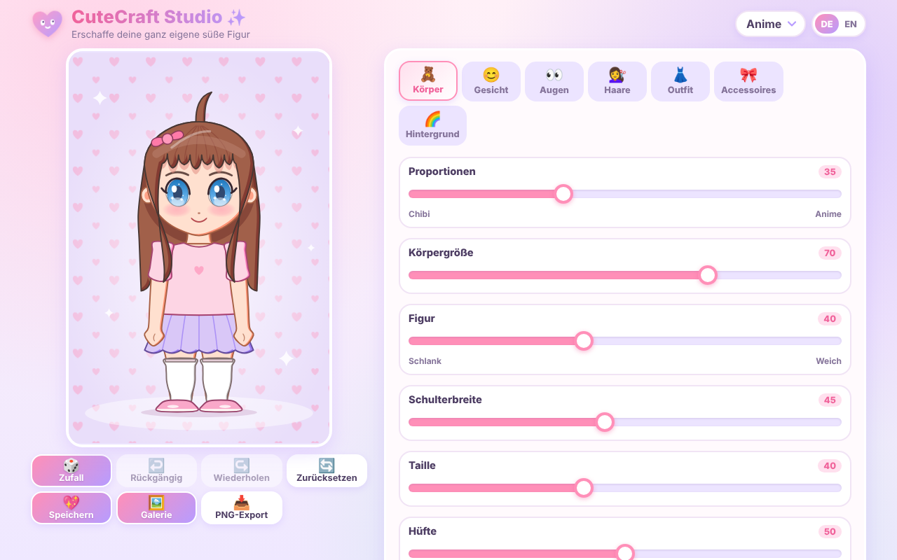

# CuteCraft Studio

A cute 2D character builder for the browser. Adjust everything from hair colour and facial features to body
proportions and outfit, and watch the character change live. The first style mode is **Anime**, drawn with normal
anime proportions. More style modes are planned, and an Android app built
from the same code.

**Try it:** <https://dr-nerdlove.github.io/cutecraft-studio/> (works on phone, tablet and PC; on a phone, "Add to home screen" installs it like an app).



## Features

- Live SVG preview, centered on a pastel background; works on phones (portrait) and on wide screens.
- Body, face, eyes, hair, outfit, accessories and background, all as sliders, colour swatches (plus custom
  colours), option chips and switches.
- Randomize (harmonious colours), reset, undo / redo, save to a gallery, export as PNG (2x).
- Feedback button: sends a message with a picture and a settings code through the system share menu (or copies it).
- Light and dark look: follows the system, with a switch in the header.
- German and English, chosen automatically from the system language (German if the system is German, otherwise English).
- Works offline: no external fonts, scripts or services. Saved characters stay in the browser (`localStorage`).

## Run it

Needs Node.js 22 and npm.

```sh
npm install
npm run dev       # dev server with hot reload
npm run build     # type check (tsc --noEmit) + production build into dist/
npm run preview   # serve the production build
npm run check     # type check only
```

The build uses relative paths (`base: './'`), so `dist/` works from any sub-path (for example GitHub Pages).

## How it is organised

```
src/core/          mode-agnostic parts: Mode interface, parameter schema, storage + migration, PNG export, colour/SVG helpers
src/modes/anime/   the anime mode: schema (parameters), geometry (all measurements), one file per body part
src/ui/            controls built generically from the schema, store with undo/redo, gallery, dialogs
src/i18n/          de.ts (source of truth) and en.ts (type-checked against de.ts: a missing text fails the build)
public/            web app manifest and icons
```

A new style mode implements the `Mode` interface (`src/core/mode.ts`) and is added to `src/core/modes.ts`.

## Build checks and publishing

Every push and pull request is built by GitHub Actions (`.github/workflows/pages.yml`: `npm ci` + `npm run build`).
A push to `main` that builds successfully is published automatically to GitHub Pages at <https://dr-nerdlove.github.io/cutecraft-studio/>.
Never upload built files by hand. One-time setup in the repository: Settings → Pages → Source: **GitHub Actions**.

## Saved data

A saved character is `{ schemaVersion, mode, params }`. Every load goes through `migrate()`
(`src/core/storage.ts`): missing parameters get their defaults, unknown ones are dropped, invalid values fall back
to the default, and corrupt storage never crashes the app. So adding parameters later does not break old saves.
Never rename a parameter key once released.

## Licence

GPL-3.0, see [LICENSE](LICENSE).
